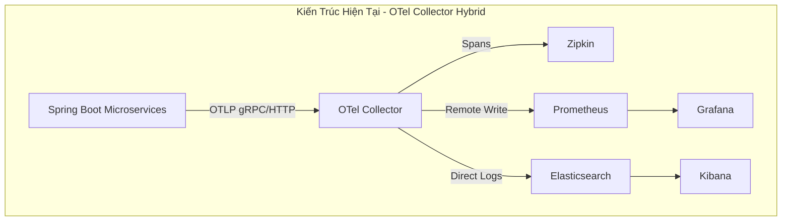
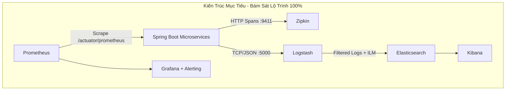

# Kịch Bản Chuyển Đổi Observability Sang Mô Hình Trực Tiếp (Direct Integration - Chuẩn ELK & Roadmap 2 Tuần)

Tài liệu này mô tả kịch bản chi tiết chuẩn Production và từng bước chuyển đổi kiến trúc giám sát (Observability) của dự án **ZChat** từ mô hình trung gian **OpenTelemetry Collector (`otel-collector`)** sang mô hình kết nối trực tiếp (**Direct Integration**), bám sát 100% lộ trình bài giảng: **Prometheus & Grafana + Zipkin + ELK Stack (Elasticsearch, Logstash, Kibana) + Alerting**.

---

## 1. So Sánh Kiến Trúc Trước & Sau Chuyển Đổi





---

## 2. Mục Tiêu Các Trụ Cột Observability

| Trụ cột | Công cụ sử dụng | Cơ chế hoạt động (Mô hình mới) | Cổng kết nối (trong Docker Network) |
| :--- | :--- | :--- | :--- |
| **Metrics Collection & Custom Metrics** | **Prometheus + Grafana** | Prometheus chủ động **Pull (Scrape)** chỉ số từ endpoint `/actuator/prometheus` của các service Spring Boot qua mạng nội bộ Docker. | Prometheus: `9091`<br>Grafana: `3001` |
| **Distributed Tracing** | **Zipkin** | Các microservice dùng Micrometer Tracing Brave đẩy trực tiếp Span/Trace về container `zipkin` qua HTTP. | Zipkin: `9411` |
| **Centralized Logging** | **ELK Stack** *(Elasticsearch, Logstash, Kibana)* | Microservice dùng Logback Appender đẩy log định dạng JSON (kèm `traceId`, `spanId`) qua TCP sang container `logstash`. Logstash parse thời gian chuẩn rồi đẩy vào **Elasticsearch**. | Logstash: `5000`<br>Elasticsearch: `9200`<br>Kibana: `5601` |
| **Alerting & Notifications** | **Grafana Alerting** *(hoặc Kibana Alerting)* | Cấu hình Alert Rules trên Grafana dựa trên chỉ số Prometheus (CPU > 80%, HTTP 5xx > 5%) để gửi thông báo ra Telegram/Discord. *(Có thể kết hợp thêm Kibana Alerting cho các cảnh báo dựa trên mẫu log lỗi nghiêm trọng)*. | N/A |

---

## 3. Lộ Trình Triển Khai Chi Tiết (Step-by-Step Plan)

### Giai Đoạn 1: Cấu hình Hạ tầng Docker (`docker-compose.yml`)

1. **Loại bỏ container `otel-collector`**:
   - Xóa service `otel-collector` và file cấu hình `otel-collector-config.yml`.
2. **Bổ sung container `logstash`**:
   - Thêm service `logstash:8.15.0` phụ thuộc vào `elasticsearch` (với `condition: service_healthy`).
   - Mở cổng `5000:5000` (TCP Input cho Logback) và mount volume file cấu hình `logstash.conf`.
3. **Cập nhật container `prometheus`**:
   - Chuyển từ cơ chế *Remote Write Receiver* sang cơ chế **Scrape Targets** cơ bản trong `prometheus.yml`.

---

### Giai Đoạn 2: Xây dựng Pipeline Logstash & ILM (`logstash/pipeline/logstash.conf`)

Tạo cấu hình Logstash xử lý chính xác timestamp gốc của log ứng dụng và liên kết Index Lifecycle Management (ILM) để tự động xóa log cũ tránh đầy đĩa:

```ruby
input {
  tcp {
    port => 5000
    codec => json_lines
  }
}

filter {
  # 1. Chuẩn hóa lại thời gian thực tế phát sinh log của ứng dụng (tránh độ trễ mạng)
  if [timestamp] {
    date {
      match => [ "timestamp", "ISO8601", "yyyy-MM-dd'T'HH:mm:ss.SSSZ" ]
      target => "@timestamp"
    }
  }

  # 2. Gắn tag cho ứng dụng ZChat
  if [logger_name] =~ "com.nguyenquyen" {
    mutate {
      add_tag => [ "zchat-service" ]
    }
  }
}

output {
  elasticsearch {
    hosts => ["http://elasticsearch:9200"]
    index => "zchat-logs-%{+YYYY.MM.dd}"
    # Áp dụng ILM policy (đã khởi tạo trong Elasticsearch để tự động dọn log sau 14 ngày)
    ilm_enabled => true
    ilm_rollover_alias => "zchat-logs"
  }
  stdout { codec => rubydebug }
}
```

---

### Giai Đoạn 3: Cập nhật Cấu hình Spring Boot Microservices

Tại tất cả các service (`common`, `api-gateway`, `user-service`, `chat-service`, ...):

#### 1. Gỡ Bỏ Triệt Để Dependency OpenTelemetry Cũ (`pom.xml`)
> [!WARNING]
> **Bắt buộc thực hiện trước**: Phải xóa sạch các thư viện OTel cũ để tránh xung đột bean `Tracer` và auto-configuration của Micrometer Tracing.

**XÓA các dependency sau:**
```diff
- <dependency>
-     <groupId>io.opentelemetry</groupId>
-     <artifactId>opentelemetry-exporter-otlp</artifactId>
- </dependency>
- <dependency>
-     <groupId>io.opentelemetry.instrumentation</groupId>
-     <artifactId>opentelemetry-logback-appender-1.0</artifactId>
- </dependency>
```
Đồng thời **XÓA file** `OpenTelemetryLoggingConfig.java` ở các service.

#### 2. Thêm Bộ Thư Viện Direct Integration (`pom.xml`)
```xml
<!-- 1. Prometheus Metrics -->
<dependency>
    <groupId>io.micrometer</groupId>
    <artifactId>micrometer-registry-prometheus</artifactId>
</dependency>

<!-- 2. Zipkin Tracing (Brave Bridge) -->
<dependency>
    <groupId>io.micrometer</groupId>
    <artifactId>micrometer-tracing-bridge-brave</artifactId>
</dependency>
<dependency>
    <groupId>io.zipkin.reporter2</groupId>
    <artifactId>zipkin-reporter-brave</artifactId>
</dependency>

<!-- 3. Logstash Logback Encoder -->
<dependency>
    <groupId>net.logstash.logback</groupId>
    <artifactId>logstash-logback-encoder</artifactId>
    <version>8.0</version>
</dependency>
```

#### 3. Cấu hình Application (`application.yml`)
Sử dụng chính xác tên hostname trong mạng Docker (`zipkin`):
```yaml
management:
  endpoints:
    web:
      exposure:
        include: health,info,prometheus,metrics
  tracing:
    sampling:
      probability: 1.0 # Lưu ý: 1.0 cho môi trường Dev/Học tập. Khi lên Production thực tế nên giảm còn 0.1 - 0.3 để tránh tràn storage Zipkin.
  zipkin:
    tracing:
      endpoint: http://zipkin:9411/api/v2/spans
```

#### 4. Cấu hình Logback (`logback-spring.xml`)
Trỏ về container `logstash:5000`, bổ sung bộ đệm `ringBufferSize` (chống block app nếu Logstash down) và ép ghi nhận `traceId`, `spanId` từ MDC để liên kết Trace $\leftrightarrow$ Log:

```xml
<configuration>
    <appender name="LOGSTASH" class="net.logstash.logback.appender.LogstashTcpSocketAppender">
        <!-- Trỏ đúng tên service trong Docker network -->
        <destination>logstash:5000</destination>
        
        <!-- Bộ đệm bộ nhớ: Nếu Logstash bị down tạm thời, app không bị nghẽn (block thread) -->
        <ringBufferSize>8192</ringBufferSize>

        <encoder class="net.logstash.logback.encoder.LogstashEncoder">
            <!-- ĐẢM BẢO LIÊN KẾT TRACE <-> LOG TRÊN KIBANA -->
            <includeMdcKeyName>traceId</includeMdcKeyName>
            <includeMdcKeyName>spanId</includeMdcKeyName>
        </encoder>
    </appender>

    <root level="INFO">
        <appender-ref ref="CONSOLE" />
        <appender-ref ref="LOGSTASH" />
    </root>
</configuration>
```

---

### Giai Đoạn 4: Cấu hình Prometheus Scrape Targets (`prometheus.yml`)

Sử dụng chính xác tên các service và cổng internal bên trong Docker Network:

```yaml
global:
  scrape_interval: 10s

scrape_configs:
  - job_name: 'zchat-api-gateway'
    metrics_path: '/actuator/prometheus'
    static_configs:
      - targets: ['api-gateway:8080']

  - job_name: 'zchat-user-service'
    metrics_path: '/actuator/prometheus'
    static_configs:
      - targets: ['user-service:8081']

  - job_name: 'zchat-chat-service'
    metrics_path: '/actuator/prometheus'
    static_configs:
      - targets: ['chat-service:8082']
```

---

### Giai Đoạn 5: Custom Metrics & Alerting

#### 1. Custom Metrics (Trong Code Java)
Đăng ký các chỉ số nghiệp vụ với `MeterRegistry`:
```java
@Service
public class ChatServiceImpl implements ChatService {
    private final Counter messageCounter;

    public ChatServiceImpl(MeterRegistry registry) {
        this.messageCounter = registry.counter("chat.messages.sent.total", "channel", "websocket");
    }

    public void sendMessage(...) {
        // Business logic...
        messageCounter.increment();
    }
}
```

#### 2. Alerting & Notifications
- **Grafana Alerting (Cho Metrics & Healthcheck)**:
  - Thiết lập Contact Point (Telegram Bot / Discord Webhook).
  - Tạo Alert Rule khi `up{job="zchat-user-service"} == 0` (Microservice bị down) hoặc `rate(http_server_requests_seconds_count{status=~"5.."}[5m]) > 5`.
- **Kibana Alerting (Cho Error Logs)**:
  - Tạo rule cảnh báo trên index `zchat-logs-*` nếu xuất hiện từ khóa `FATAL` hoặc `OutOfMemoryError` quá 3 lần trong 5 phút.

---

## 4. Tiêu Chuẩn Nghiệm Thu & Kiểm Chứng Liên Kết (Checklist)

- [ ] **Gỡ sạch OTel**: Kiểm tra lệnh `mvn dependency:tree` không còn xuất hiện `opentelemetry-exporter-otlp`.
- [ ] **Kiểm thử liên kết Trace $\leftrightarrow$ Log (Quan trọng nhất)**:
  1. Gửi 1 request API tạo dữ liệu qua Postman tới API Gateway (ví dụ: `POST /api/v1/auth/login`).
  2. Mở **Zipkin UI** (`http://localhost:9411`), tìm request vừa gọi và copy mã `traceId` (ví dụ: `66840ef7a1d...`).
  3. Mở **Kibana Discover** (`http://localhost:5601`), lọc trên index `zchat-logs-*` với query `traceId: "66840ef7a1d..."`.
  4. **Xác nhận**: Kibana trả về đầy đủ các dòng log tương ứng của request đó đi từ API Gateway $\rightarrow$ User Service.
- [ ] **Khả năng chịu lỗi (Resilience)**: Thử tắt container `logstash` (`docker stop logstash`) $\rightarrow$ Các microservice Spring Boot vẫn hoạt động bình thường, không bị nghẽn request nhờ `ringBufferSize`.
- [ ] **Prometheus & Grafana**: Vào `http://localhost:9091/targets` xác nhận 100% service trạng thái `UP`. Dashboard Grafana hiển thị biểu đồ Custom Metric `chat_messages_sent_total`.
