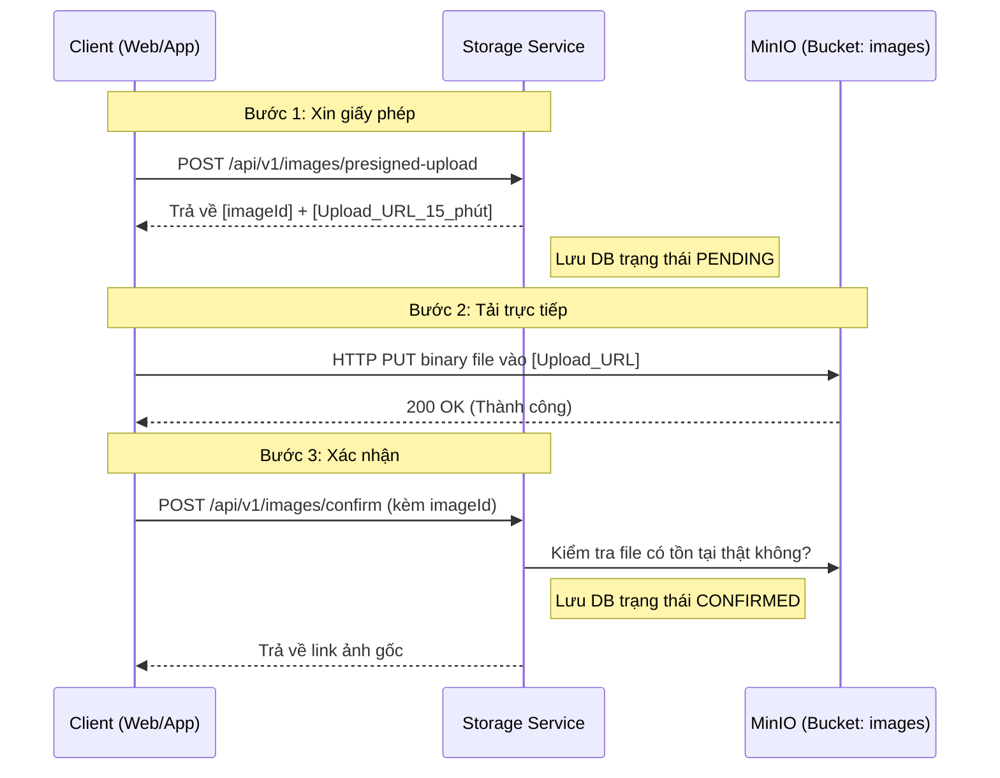

# Storage Service

Đây là service chịu trách nhiệm quản lý việc lưu trữ hình ảnh và file cho toàn bộ hệ thống ZChat. Service này sử dụng **MinIO** (chuẩn S3) để lưu trữ file vật lý và **PostgreSQL** để lưu trữ siêu dữ liệu (metadata).

## 🌟 Điểm nổi bật của Kiến trúc
- Sử dụng mô hình **Presigned URL** (cấp phép tạm thời) để giảm tải hoàn toàn băng thông cho server Java. File được đẩy thẳng từ Client lên MinIO.
- Sử dụng bucket `images` để lưu trữ ảnh gốc.
- Cơ chế tự động dọn rác (Garbage Collection) với các file rác bị huỷ upload giữa chừng.

---

## 🌊 Các luồng xử lý chính (Data Flows)

### 1. Luồng Tải ảnh lên (Image Upload Flow)
Đây là luồng quan trọng nhất, giải quyết bài toán thắt nút cổ chai (bottleneck) khi có nhiều người dùng cùng tải file.

**Chi tiết các bước:**
1. **Xin giấy phép (`/presigned-upload`)**: Client gửi siêu dữ liệu (tên file, kích thước). Server tạo một ID (UUID) lưu vào DB với trạng thái `PENDING` và cấp một đường link Upload (chỉ có hạn trong 15 phút).
2. **Tải trực tiếp**: Client dùng đường link trên để đẩy thẳng luồng byte (binary) của file lên MinIO. Server Java không hề can thiệp.
3. **Xác nhận (`/confirm`)**: Client báo cáo đã tải xong. Server kiểm chứng với MinIO. Nếu đúng, server sẽ đổi trạng thái DB thành `CONFIRMED` và hoàn tất.

---

### 2. Luồng Tải/Xem ảnh (Download/View Flow)
Có 2 cách để xem ảnh, ưu tiên sử dụng Cách 1:

**Cách 1: Lấy URL tạm thời (Khuyên dùng)**
- Client gọi `GET /api/v1/images/{imageId}/url`.
- Server cấp một Presigned GET URL của MinIO (hạn 24 giờ).
- Client dùng URL này đặt vào thẻ ``. Client tải file trực tiếp từ MinIO, không qua Server.

**Cách 2: Tải qua Proxy**
- Client gọi `GET /api/v1/images/{imageId}`.
- Server Java kết nối MinIO, tải file về RAM rồi đẩy luồng (Stream) ngược lại cho Client. 
- *Nhược điểm:* Tốn băng thông server Java, chỉ dùng khi Client bị block không gọi thẳng được vào MinIO.

---

### 3. Luồng Dọn rác tự động (Cleanup Background Job)
Do cơ chế cấp phép Presigned URL, sẽ có trường hợp Client "xin giấy phép" nhưng rớt mạng không thực hiện Bước 2 và Bước 3. Việc này sinh ra các file `PENDING` rác trong Database.

**Hoạt động của `ImageCleanupScheduler`:**
1. Định kỳ 1 tiếng 1 lần (cấu hình `interval-ms`), Job sẽ thức dậy.
2. Tìm trong Database những dòng có trạng thái `PENDING` và thời gian tạo đã quá 2 tiếng (`pending-expiry-hours`).
3. Đánh dấu các dòng đó thành `EXPIRED` (chỉ xóa mềm).
4. Gửi lệnh xóa (Remove) file rác tương ứng trên MinIO (nếu có).

---

## 📚 Danh sách API (API Reference)

| Phương thức | Endpoint | Chức năng |
|---|---|---|
| `POST` | `/api/v1/images/presigned-upload` | Xin cấp URL tải file lên MinIO |
| `POST` | `/api/v1/images/confirm` | Báo cáo MinIO đã nhận được file |
| `GET` | `/api/v1/images/{imageId}/url` | Lấy URL (Presigned) để tải/xem ảnh trực tiếp từ MinIO |
| `GET` | `/api/v1/images/{imageId}` | Tải ảnh trực tiếp qua proxy của Java Server |
| `GET` | `/api/v1/images/{imageId}/metadata` | Lấy siêu dữ liệu (kích thước, định dạng, size) của ảnh |
| `GET` | `/api/v1/images/list` | Lấy danh sách metadata của các ảnh đã upload thành công |
| `DELETE` | `/api/v1/images/{imageId}` | Xóa cứng file trên MinIO & xóa mềm trạng thái về `DELETED` |